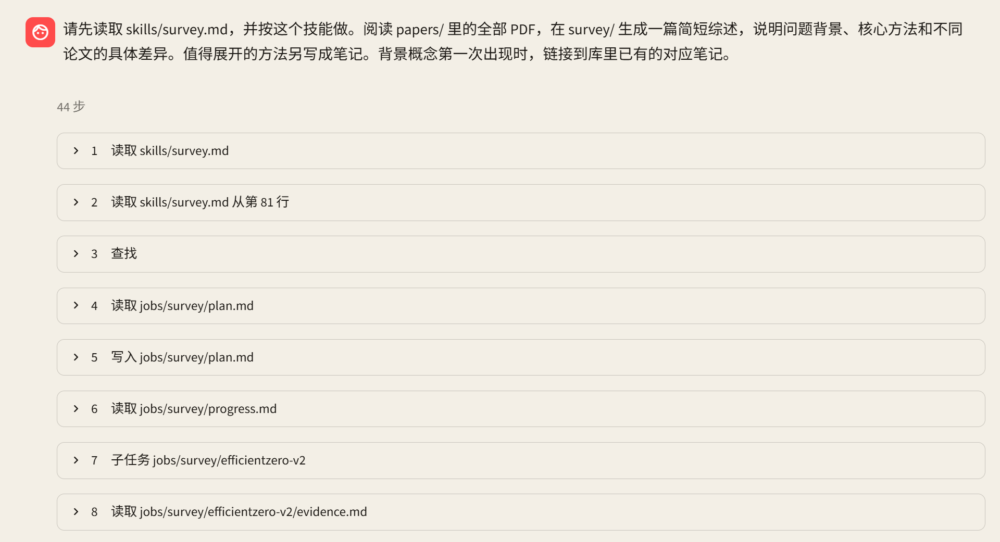
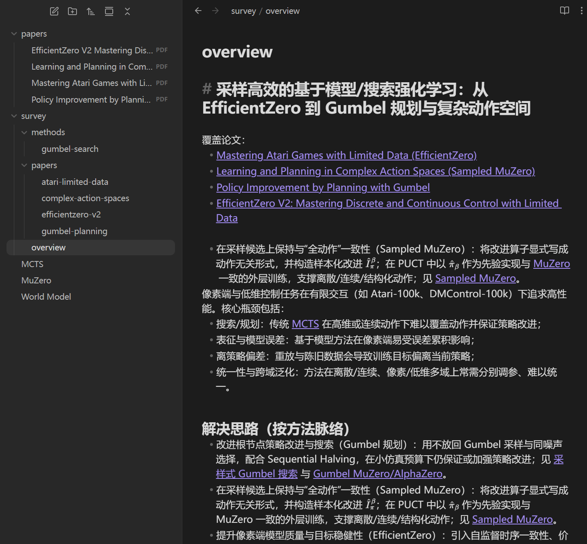

# Obsidian Assistant

[中文](README.md) | English

A lightweight agent for an Obsidian vault. It answers questions from notes, reads papers, edits notes, and writes surveys across multiple papers.

The project runs a ReAct loop: the model decides what to search, read, and call; the program handles file access, context isolation, and write confirmation. Markdown is the source of knowledge. Evidence and drafts live in a separate workspace.

## What it does

| Task | How |
| --- | --- |
| Vault Q&A | Search notes, read the source text, and answer facts, numbers, and experiment settings |
| Paper reading | Read a PDF in pages, then write a paper note or a conference-style review |
| Survey | Give each paper its own reading subtask, gather evidence, compare methods, and write linked notes |
| Note maintenance | Create or edit a note after confirmation, and check outgoing links, backlinks, and unresolved links |

The CLI and the Streamlit app share one agent. The web app keeps the session, shows tool progress, asks before writing a note, and can switch between Chinese and English.

## Showcase: a survey from a folder of papers

> Read the papers in `papers/opd/` and write a short survey in `survey/opd/`. Cover the problem, the core methods, and the concrete differences. Turn a method that needs more space into its own note. The first time a background concept appears, link it to the note already in the vault.

The start of one survey in the web app. The question is at the top. The first eight steps read the skill, write the plan, dispatch a subtask, and open its evidence. That turn ran 44 steps.



`survey/overview.md` after one run: paper notes, a method note, and links to concepts already in the vault.



What happens:

1. **Load the skill and find the files.** Read `survey`, locate the PDFs, and make a paper list.
2. **Read in isolation and keep the evidence.** Each subtask reads on its own and writes evidence and drafts into the given workspace directory.
3. **Compare and assemble.** The parent receives the status, the file paths, and a short report, then reads evidence as needed, writes the survey, and links existing notes.
4. **Confirm and check.** After you confirm, the notes are written into the vault and unresolved links are checked.

Tool results from a single paper stay in the subtask. The parent keeps the coordination and the paths to the materials. Evidence moves through workspace files.

Other examples:

> Using the PPO notes in the vault, explain what clipping does and cite the note.

> Show this note's backlinks, and the links that point at notes which do not exist yet.

Replace the example paths with files in your own vault.

## Design

| Mechanism | What it does |
| --- | --- |
| Model-driven loop | Run tool calls and return each result or error to the model until it answers |
| Skills on demand | The system prompt lists skill names and short descriptions. The body is read after the task matches |
| Deferred tools | A tool that is not always resident gets its schema from `tool_describe` or from a skill header |
| Subtask isolation | `run_subtask` starts from an empty context and cooperates through the task text and output paths |
| Two roots | The vault holds your notes and PDFs. Its `.assistant/` folder holds skills, sessions, and task files |
| Spill long results | Past 40,000 estimated tokens, earlier tool results are stored in the workspace and the history keeps a stub plus a path. Past 100,000, the latest batch is stored the same way |
| Traces | Streamlit shows tool progress. A finished turn can be sent to Langfuse |

A subtask does not see the parent conversation or the skill body. The parent passes the rules in the task. The subtask can write only inside the given directory. It cannot edit the vault or start another subtask.

### Retrieval and files

- **Search.** BM25 over Markdown chunks, with jieba for Chinese and English. A snippet locates a passage. The answer comes from the text read afterward.
- **Pages.** A note or workspace file returns at most 80 lines. A PDF returns at most 4 pages.
- **Links.** Obsidian wikilinks are resolved when asked: outgoing, backlinks, and unresolved.
- **Writes.** Vault edits wait for confirmation. `write_file` writes workspace Markdown immediately, and refuses `skills/` and `sessions/`.
- **Sessions.** The web app keeps history and spills tool results only after a token threshold. Each terminal question is separate and is not compacted.

### Built-in skills

| Skill | Use |
| --- | --- |
| `research` | Answer facts, configuration, and experiment settings from existing notes |
| `paper-note` | Turn one PDF into a paper note |
| `paper-review` | Write a review in a conference review form |
| `survey` | Read several PDFs and write a survey plus related notes |

The copies shipped with the repo are in `src/skills/default/`. On startup, a missing workspace file is copied from there. A file you already edited is left as it is. Skill bodies are read from disk each time. A changed catalog description is picked up after a restart.

## Quick start

Requires **Python 3.13** and [uv](https://docs.astral.sh/uv/).

```powershell
uv sync
```

On the first launch, if the API key is missing, the CLI or the web page asks for it and writes `.env`. You can also create that file yourself:

```dotenv
OPENAI_API_KEY=your_openai_api_key
VAULT=

# Optional: model and endpoint. Omit either line to keep gpt-5 and https://api.openai.com/v1
# OPENAI_MODEL=gpt-5
# OPENAI_BASE_URL=https://api.openai.com/v1

# Optional: enable Langfuse
LANGFUSE_PUBLIC_KEY=your_langfuse_public_key
LANGFUSE_SECRET_KEY=your_langfuse_secret_key
```

An existing environment variable wins over `.env`. When `OPENAI_MODEL` or `OPENAI_BASE_URL` is absent, the client uses `gpt-5` and `https://api.openai.com/v1` through OpenAI Chat Completions. Restart after editing.

When `VAULT` is empty, the first launch asks for a notes folder. The terminal opens the system folder dialog, and a pasted path works if that dialog is cancelled. The web page has a browse button. In the sidebar, Change vault (更换笔记库 in Chinese) rewrites this line. The absolute path is stored as `VAULT` in `.env` and reused on the next launch. The workspace is `<vault>/.assistant/`, which note search does not read.

Start either entry:

```powershell
# CLI
uv run python main.py

# Web
uv run streamlit run ui/app.py
```

Choose the vault again from the terminal with:

```powershell
uv run python main.py --vault
```

In the terminal, an empty line or `quit` exits, and `yes` confirms a note edit. The web app uses a confirmation card. Restart a running process after changing code or the skill catalog.

Step limits and compaction thresholds can be changed in `settings.toml` at the project root. A missing file, or a missing line, keeps the program default. The keys are listed in `settings.example.toml`: `max_steps` for the parent agent (128), `subtask_steps` for one subtask (40), `compact_light` where earlier tool results spill (40000), and `compact_heavy` where the latest batch spills too (100000). Restart after editing. Each terminal question is separate and is not compacted, so the last two affect the web app and the benchmark.

## Benchmark and tests

```powershell
# List tasks. No model call.
uv run python benchmark/run.py --list

# Run one category or one task
uv run python benchmark/run.py --category note-qa
uv run python benchmark/run.py --id ppo-clip

# Full benchmark and unit tests
uv run python benchmark/run.py
uv run pytest
```

Tasks are in `benchmark/tasks.json`. A full run writes `benchmark/last_run.json` and `benchmark/last_run.html`. A filtered run leaves that full report in place.

The benchmark calls the model API. The fixture vault is not in the repo. `uv run python benchmark/build_test_vault.py` writes `benchmark/test_vault/` and replaces that directory if it already exists. Unit tests live in `tests/`, which is not in git.

## Layout

| Path | Role |
| --- | --- |
| `src/entry.py` | Build the agent and its tools |
| `src/config.py` | Vault path, and the step and compaction numbers in `settings.toml` |
| `src/agent/` | Loop, context, model client, and trace |
| `src/tools/` | Tool registry and file operations |
| `src/retrieval/` | Markdown chunks and BM25 |
| `src/skills/default/` | Skills shipped with the repo |
| `src/sessions.py` / `src/compact.py` | Web sessions and spilled tool results |
| `ui/` | Streamlit page, copy, and tool steps |
| `benchmark/` | Tasks and reports |
